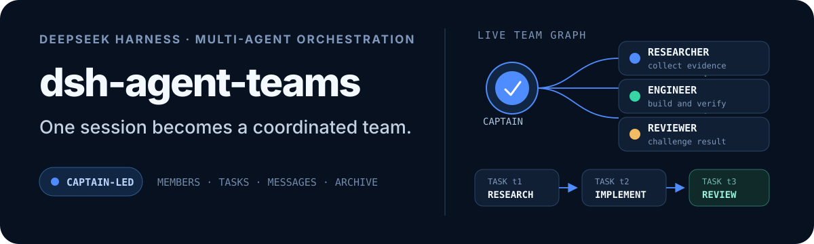

<p align="right">
  <strong>简体中文</strong> · <a href="./README_EN.md">English</a>
</p>

<p align="center">
  
</p>

# dsh-maestro

> 一个队长决策、队员干活的 DeepSeek Harness 多智能体编排插件。
>
> **本项目二改自 [NanmiCoder/dsh-agent-teams](https://github.com/NanmiCoder/dsh-agent-teams)。**

## 这是什么

`dsh-maestro` 把当前会话变成一支团队：**你选定的模型担任队长**，负责架构决策、任务拆解与最终集成；**拉起的一批低成本子智能体担任队员**，并行完成互相隔离的原子任务。

它不引入新的工作流引擎。服务端注册 14 个协调工具，写一份可脚本化的磁盘状态，Web 端提供一块实时活动面板；队长用自然语言就能驱动整条链路。

## 与上游的差异

本仓库是对上游 `dsh-agent-teams` 的二改版本，改动集中在以下几点：

| 方面 | 上游 `dsh-agent-teams` | 本仓库 `dsh-maestro` |
| --- | --- | --- |
| 包标识 | `@nanmicoder/dsh-agent-teams` | `@local/dsh-maestro` |
| 插件注册名 | `agent-teams` | `dsh-maestro` |
| 状态目录 | `.agent-teams` | `.maestro` |
| Web 路由前缀 | `/plugins/dsh-agent-teams/` | `/plugins/dsh-maestro/` |
| 预设来源 | 需另建 bundle 声明 | 由插件自身注册 `team` 预设 |
| 团队入口 | 会话头部按钮 + 右侧栏标签 | 仅保留活动面板（编队界面） |
| 侧栏面板 | — | 已移除 |
| 模型设置页 | — | 已移除 |

**保留的唯一 UI 是编队界面**：队伍卡片、成员列表、任务板、依赖关系、staged 计划编辑。侧栏图标、团队设置页与模型配置页均已删除。

**队员如何区分**：不再注册「团队模式-队员」这类会出现在新建会话菜单里的预设。队员继承队长预设，由 `executionPrompt` 定义职责，并由运行时的队长专属工具拒绝规则自动收窄权限（详见 `src/tool-policies.ts`）。

## 安装

```bash
# 从本地路径安装
dsh plugin --profile desktop add C:\path\to\dsh-maestro

# 或先构建再安装
pnpm install && pnpm build
dsh plugin --profile desktop add C:\path\to\dsh-maestro
```

安装后重启 DeepSeek Harness，新建会话时在预设菜单选择 **团队模式**。

## 用法

选好模型（它会成为队长，全程不变），然后直接用自然语言描述目标：

```
用团队模式重构这个项目的认证模块，先拆任务再并行实现。
```

队长会：勘测目录 → 亲自落盘接口契约 → 拆解原子任务（含独占文件范围与自检标准）→ 拉起队员并指定模型 → 汇总结果 → 亲自处理入口挂载与全量集成。

界面入口是会话内的**编队**视图，展示队伍、任务依赖与实时进展。

### 模型分层

队长模型由你在会话框选定。队员可以使用哪些模型，由 DSH 内置的 **插件 → Subagent → 模型选择** 决定；开启并把低成本模型加入白名单后，队长就能为不同难度的原子任务挑选不同路由。

## 工具一览

| 工具 | 用途 |
| --- | --- |
| `agent_teams_create` | 建队并声明成员与任务 |
| `agent_teams_add_member` / `agent_teams_remove_member` | 增删队员 |
| `agent_teams_create_task` / `agent_teams_amend_task` | 建任务、修订契约 |
| `agent_teams_reassign_task` | 重新指派或接管 |
| `agent_teams_claim_task` / `agent_teams_update_task` | 队员认领与提交 |
| `agent_teams_send_message` | 队长与队员通信 |
| `agent_teams_status` | 查询队伍与任务状态 |
| `agent_teams_edit_plan` / `agent_teams_approve` | 计划编辑与确认 |
| `agent_teams_resume` / `agent_teams_delete` | 恢复与归档 |

## 开发

```bash
pnpm install
pnpm build        # 构建 Host 与浏览器两端产物
pnpm typecheck    # 双端类型检查
pnpm verify       # 完整校验（含兼容性与契约测试）
```

- `src/index.ts` — Host 侧入口，注册工具、Web 路由与预设
- `src/tools.ts` — 14 个协调工具的实现
- `src/presets.ts` — `team` 预设组合与队长指令
- `src/client/` — 浏览器端活动面板与卡片渲染
- `cordis.patch.yml` — bundle 挂载声明

## 兼容性

已知可用宿主：DeepSeek Harness `0.2.2-rc.x`。构建依赖固定在 `0.2.1-rc.2` 的类型声明；运行时不依赖该版本。完整矩阵见 [`compatibility.json`](./compatibility.json)。

## 许可

[MIT](./LICENSE)。原始版权归 [NanmiCoder](https://github.com/NanmiCoder) 及 `dsh-agent-teams` 贡献者所有；本仓库的修改部分同样以 MIT 发布。
