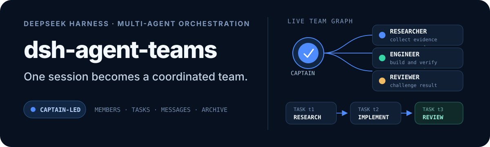

<p align="right">
  <a href="./README.md">简体中文</a> · <strong>English</strong>
</p>

<p align="center">
  
</p>

# dsh-maestro

> A multi-agent orchestration plugin for DeepSeek Harness where a strong captain decides and cheap workers execute.
>
> **Second-party fork of [NanmiCoder/dsh-agent-teams](https://github.com/NanmiCoder/dsh-agent-teams).**

## What it does

`dsh-maestro` turns the current session into a team. **The model you picked becomes the captain** — it owns architecture decisions, task decomposition, and final integration. **The teammates it spawns are low-cost sub-agents** working on isolated atomic tasks in parallel.

No separate workflow engine is involved. The Host registers 14 coordination tools, persists scriptable state on disk, and the Web surface renders one live activity panel.

## Differences from upstream

| Aspect | Upstream `dsh-agent-teams` | This fork `dsh-maestro` |
| --- | --- | --- |
| Package | `@nanmicoder/dsh-agent-teams` | `@local/dsh-maestro` |
| Registration name | `agent-teams` | `dsh-maestro` |
| State directory | `.agent-teams` | `.maestro` |
| Web route prefix | `/plugins/dsh-agent-teams/` | `/plugins/dsh-maestro/` |
| Preset source | Required a separate bundle | Declared by the plugin itself (`team`) |
| Team entry | Header button + right-column tab | Activity panel only |
| Sidebar panel | — | Removed |
| Model settings page | — | Removed |

**Only the team activity panel remains** — team cards, member roster, task board, dependencies, and the staged plan editor. The sidebar icon, the team settings page, and the model configuration page are gone.

**How teammates are distinguished**: no second pickable preset such as "team-worker" is registered, because the new-session picker lists every registered preset. Teammates inherit the captain preset, receive their scope through `executionPrompt`, and are narrowed automatically by the runtime's captain-only tool denial (see `src/tool-policies.ts`).

## Install

```bash
dsh plugin --profile desktop add C:\path\to\dsh-maestro

# or build first
pnpm install && pnpm build
dsh plugin --profile desktop add C:\path\to\dsh-maestro
```

Restart DeepSeek Harness, then pick **团队模式** in the new-session preset menu.

## Usage

Choose a model (it becomes the captain and never changes), then describe the goal in natural language:

```
Refactor the auth module with team mode: decompose first, then implement in parallel.
```

The captain surveys the tree, writes the interface contract itself, decomposes atomic tasks (each with an exclusive file scope and self-check command), spawns teammates on chosen models, collects results, then handles entry-point mounting and full integration.

The in-conversation **team activity panel** shows the roster, task dependencies, and live progress.

### Model tiers

The captain runs on the model you selected in the composer. Which models teammates may use is decided by DSH's built-in **Plugins → Subagent → model selection** allowlist; enable it and add cheaper models so the captain can route each atomic task to a different tier.

## Tools

| Tool | Purpose |
| --- | --- |
| `agent_teams_create` | Create a team with members and tasks |
| `agent_teams_add_member` / `agent_teams_remove_member` | Add and remove teammates |
| `agent_teams_create_task` / `agent_teams_amend_task` | Create tasks, amend contracts |
| `agent_teams_reassign_task` | Retry, reassign, or take over |
| `agent_teams_claim_task` / `agent_teams_update_task` | Teammate claim and report |
| `agent_teams_send_message` | Captain and teammate messaging |
| `agent_teams_status` | Team and task status |
| `agent_teams_edit_plan` / `agent_teams_approve` | Plan editing and approval |
| `agent_teams_resume` / `agent_teams_delete` | Resume and archive |

## Development

```bash
pnpm install
pnpm build        # Host and browser bundles
pnpm typecheck    # Both sides
pnpm verify       # Full verification
```

- `src/index.ts` — Host entry: tools, web routes, preset registration
- `src/tools.ts` — the 14 coordination tools
- `src/presets.ts` — the `team` preset composition and captain brief
- `src/client/` — browser activity panel and card rendering
- `cordis.patch.yml` — bundle mount declaration

## Compatibility

Tested against DeepSeek Harness `0.2.2-rc.x`. The build pins type declarations at `0.2.1-rc.2`; the runtime does not depend on that version. See [`compatibility.json`](./compatibility.json).

## License

[MIT](./LICENSE). Original copyright belongs to [NanmiCoder](https://github.com/NanmiCoder) and the `dsh-agent-teams` contributors; modifications in this fork are released under the same license.
